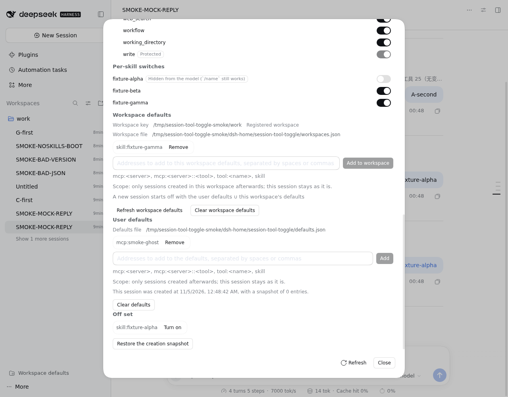
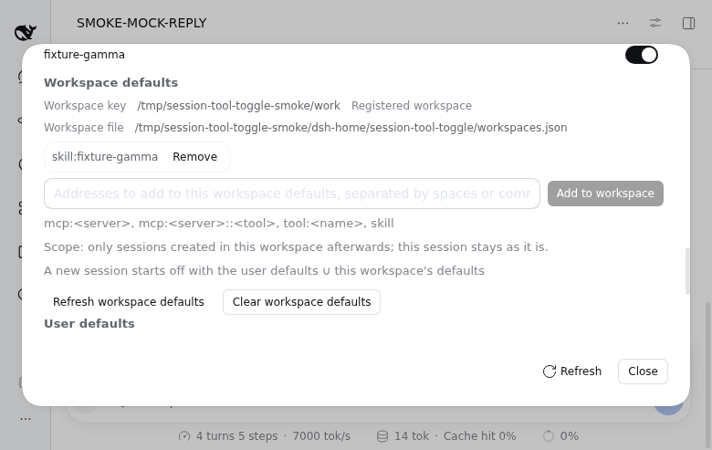
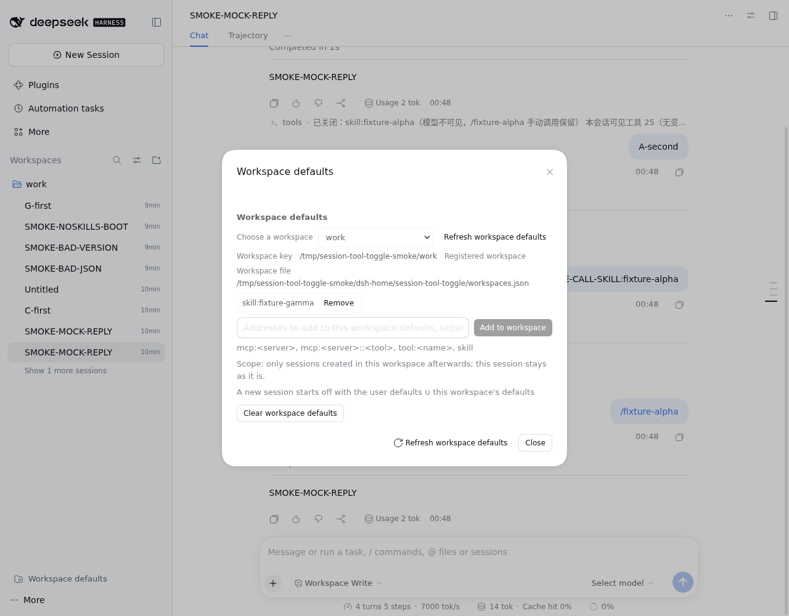

# 隔离实例冒烟与浏览器证据（tasks.md 8.2）

- 变更：`session-tool-toggle-skill-workspace`
- 任务：`tasks.md` 8.2（隔离实例冒烟 6 条 + chrome-devtools 三张截图）
- 执行时间：2026-11-04 00:38 – 2026-11-05 01:24（Asia/Shanghai）
- dsh：`0.2.1-rc.5`；目标插件：工作区 `plugins/session-tool-toggle`（`link:` 安装，`lib/` 为当前构建产物）
- 结论：**6 条冒烟全部通过**（含真实浏览器截图 3 张，无截图兜底）；11 条机读校验全绿
- 宿主：PID 1 `node /usr/local/bin/dsh web --no-open`（端口 3080）全程存活、未被触碰（见 §8）

## 0. 执行口径（R8 裁定，随任务落档）

1. **隔离实例**：全部冒烟在独立 `DSH_HOME=/tmp/session-tool-toggle-smoke/dsh-home` 上进行，配 3 个 fixture skill（`skills/fixture-{alpha,beta,gamma}`）与最小实验插件（进程内 mock LLM adapter + 命令驱动插件）；**未读取、未写入任何真实凭据**。
2. **独立端口 web 表层**：`127.0.0.1:3987`（截图用）与 `127.0.0.1:3989`（无 skills 组合探测用），均以自记 PID 启动、用后清理；**绝不碰 3080 与宿主进程**。
3. **本插件装隔离实例用 `link:` 指向插件目录**（build 后 `lib/` 即新产物；本任务未重建、未改源码）：
   ```bash
   cd /tmp/session-tool-toggle-smoke
   DSH_HOME=$PWD/dsh-home dsh plugin --profile headless add \
     link:/home/xuqinqin/develop/person/dsh-plugins/plugins/session-tool-toggle
   ```
   观察：profile `package.json` 的 `dsh.profile.bundles` 自动追加 `dsh-plugin-session-tool-toggle`，`node_modules/dsh-plugin-session-tool-toggle -> ../../../../../../home/.../plugins/session-tool-toggle`。
4. **live `~/.dsh` 的 `stat -c '%a'` 断言移到 9.3**：重启后宿主半才会写 `~/.dsh/session-tool-toggle/workspaces.json`，而重启属硬停③须经用户确认；本任务改为断言**隔离 `DSH_HOME` 下的同值权限位**（数值同为 600/700，路径为 /tmp 隔离树）。本任务全程未触碰 `~/.dsh`。
5. **headless 表层没有命令适配器**（`dsh-commands/README.zh.md`：「无 UI 的演示……不提供此命令面」），因此 `/tools` 由实验驱动插件调用 `commands.execute(agent, line, [], signal)`——**与 UI 适配器同一条命令执行入口**，命令生命周期（`command/run` / `command/done`）照常写入会话日志。
6. **截图方式**：本执行子代理工具集不含 `mcp__chrome-devtools-mcp__*`；改用本机 `/usr/bin/chromium`（155.0.8059.79）headless + CDP（`Page.navigate` / `Runtime.evaluate` / `Page.captureScreenshot`）完成真实浏览器取证。三张截图均为真实页面，**不是兜底**。UI 语言为 en（Chromium 默认 `navigator.languages`），截图内标签为英文；代码内的中文键见 `locales.ts`。

### 0.1 隔离装配

| 项 | 值 |
|---|---|
| `DSH_HOME` | `/tmp/session-tool-toggle-smoke/dsh-home` |
| profile | `headless`（机制冒烟）、`web`（截图）、`noskills`（无 skills 组合） |
| fixture skills | `skills/fixture-alpha`、`fixture-beta`、`fixture-gamma`（`customSkillDirs`，`includeDefaultRoots: false`） |
| 模型 | 进程内 mock adapter（provider `smoke-mock` / model `mock-1`），零真实 token |
| 实验插件 | `mock/`（mock LLM + `SMOKE-CALL-SKILL:<name>` 触发真实 `skill` 工具调用）、`driver/`（按场景驱动真实 `commands.execute` 并落观察值）、`fake-services/`（仅无 skills 快照用：伪 `connection`/`webServer` 捕获 RPC handler） |
| 目标插件 | `link:` 安装，profile bundles 含 `dsh-plugin-session-tool-toggle` |
| 证据 | 会话日志 `dsh-home/sessions/.../session*.v4.jsonl.zstd`、驱动事件 `evidence/driver-events.jsonl`、校验 `evidence/verify-main.json` |

## 1. 技能翻转：只出一条目录替换消息、`skill` 工具拒调、`/name` 全正文

### 命令

```bash
cd /tmp/session-tool-toggle-smoke/work
DSH_HOME=/tmp/session-tool-toggle-smoke/dsh-home SMOKE_SCENARIO=main \
  dsh --profile headless --json 'SMOKE-BOOT' \
  > ../logs/main-run.jsonl 2> ../logs/main-run.err
# 退出码 0；final = SMOKE-MOCK-REPLY

# 驱动插件在 session-smoke-a 上的动作（真实命令入口）：
#   1) 一轮 "A-first"（产生首份目录消息）
#   2) /tools off skill:fixture-alpha
#   3) 一轮 "A-second"（产生替换目录消息）
#   4) 一轮 "SMOKE-CALL-SKILL:fixture-alpha"（mock 模型发出真实 skill 工具调用）
#   5) 一轮 "/fixture-alpha"（手动调用注入）

# 观察：解压会话日志 + 机读校验
cd /tmp/session-tool-toggle-smoke
node scripts/dump.mjs \
  dsh-home/sessions/--tmp-session-tool-toggle-smoke-work--/session-smoke-a/session.v4.jsonl.zstd A
node scripts/verify-main.mjs
```

### 观察输出

`/tools off skill:fixture-alpha` 回执：

```text
已关闭：skill:fixture-alpha（模型不可见，/fixture-alpha 手动调用保留）
本会话可见工具 25（无变化）
skill 是技能目录工具：一次开关会触发一次技能目录替换消息（模型侧可见的一次性成本）；被关技能模型不可见，/<技能名> 手动调用保留
```

会话 A 的 `skill-catalog` 消息（`source.kind === 'skill-catalog'`）：

```json
[
  { "seq": 13, "update": false, "names": ["fixture-alpha", "fixture-beta", "fixture-gamma"] },
  { "seq": 30, "update": true,  "names": ["fixture-beta", "fixture-gamma"] }
]
```

- 翻转后**恰一条** `update=true` 的替换消息（`verify-main` 的 `1a/1b` PASS），替换份不含 `fixture-alpha`。

`skill` 工具调用（模型侧真实发起，`tool/result`，`isError: true`）：

```json
{"type":"tool/result","data":{"message":{"role":"tool","content":[{"type":"text","text":"Error: skill \"fixture-alpha\" is not available for model invocation"}],"isError":true}}}
```

`/fixture-alpha` 注入（`source.kind === 'skill-invocation'`，`source.name === "fixture-alpha"`）：

```json
{ "seq": 52, "bodySha256": "fd6cd709a02884518e44eb9f5f94f2864617a5451a332310b4f8eba3e8c060cd",
  "diskSha256": "fd6cd709a02884518e44eb9f5f94f2864617a5451a332310b4f8eba3e8c060cd", "bytes": 78 }
```

```bash
node -e "const fs=require('fs'),c=require('crypto');const raw=fs.readFileSync('/tmp/session-tool-toggle-smoke/skills/fixture-alpha/SKILL.md','utf8');const body=/^---\n[\s\S]*?\n---\n([\s\S]*)$/.exec(raw)[1].trim();console.log(Buffer.byteLength(body), c.createHash('sha256').update(body).digest('hex'))"
# 78 fd6cd709a02884518e44eb9f5f94f2864617a5451a332310b4f8eba3e8c060cd
```

结论：**通过**（`1a`–`1d` 全 PASS；正文与磁盘 SKILL.md 逐字节一致）。

## 2. 批量一次一单：一次关 3 个 fixture → 仅一条替换消息

### 命令

驱动插件在 `session-smoke-b` 上：

```text
1) 一轮 "B-first"
2) /tools off skill:fixture-alpha skill:fixture-beta skill:fixture-gamma   # 一条命令三个地址
3) 一轮 "B-second"
```

```bash
cd /tmp/session-tool-toggle-smoke
node scripts/dump.mjs \
  dsh-home/sessions/--tmp-session-tool-toggle-smoke-work--/session-smoke-b/session.v4.jsonl.zstd B
```

### 观察输出

批量回执（一条命令、三条关闭项）：

```text
已关闭：skill:fixture-alpha（模型不可见，/fixture-alpha 手动调用保留）
已关闭：skill:fixture-beta（模型不可见，/fixture-beta 手动调用保留）
已关闭：skill:fixture-gamma（模型不可见，/fixture-gamma 手动调用保留）
本会话可见工具 25（无变化）
skill 是技能目录工具：一次开关会触发一次技能目录替换消息（模型侧可见的一次性成本）；被关技能模型不可见，/<技能名> 手动调用保留
```

会话 B 的目录消息：

```json
[
  { "seq": 11, "update": false, "names": ["fixture-alpha", "fixture-beta", "fixture-gamma"] },
  { "seq": 28, "update": true,  "names": [] }
]
```

结论：**通过**（`2` PASS：批量后仅一条替换消息，目录条目为空）。

## 3. 重复关无字节变化 + 工作区档权限 600/700 + 当前会话不变 / 新会话首步生效 / reset 回合并快照

### 命令

驱动插件在 `session-smoke-c` / `session-smoke-d` 上（按序）：

```text
C: /tools default off mcp:smoke-ghost          # 建 defaults.json
   /tools workspace off skill:fixture-gamma    # 建 workspaces.json（600/700）
   /tools status                              # 当前会话不变
   一轮 "C-first"
   /tools off skill:fixture-alpha             # 首次关
   （driver 打点：repeat-window-before，含两文件 sha256/大小/权限）
   /tools off skill:fixture-alpha             # 重复关
   （driver 打点：repeat-window-after）
D: 新建（工作区档已写）→ /tools status（未跑任何 turn）
   /tools off skill:fixture-alpha → /tools reset → /tools status
```

```bash
cd /tmp/session-tool-toggle-smoke
node scripts/dump.mjs \
  dsh-home/sessions/--tmp-session-tool-toggle-smoke-work--/session-smoke-c/session.v4.jsonl.zstd C
node scripts/dump.mjs \
  dsh-home/sessions/--tmp-session-tool-toggle-smoke-work--/session-smoke-d/session.v4.jsonl.zstd D
stat -c '%a' /tmp/session-tool-toggle-smoke/dsh-home/session-tool-toggle \
             /tmp/session-tool-toggle-smoke/dsh-home/session-tool-toggle/workspaces.json \
             /tmp/session-tool-toggle-smoke/dsh-home/session-tool-toggle/defaults.json
```

### 观察输出

**重复关无字节变化**（`repeat-window-before/after`，两次 `/tools off skill:fixture-alpha` 之间）：

```json
{"defaults":{"exists":true,"sha256":"f5b7d8c4a2aa9107ed486e547d030f9e74252dede413a117da526bf0764b60df","bytes":62,"mode":"600"},"workspaces":{"exists":true,"sha256":"4e83fe624dcb38ddbad8d355dd19417d80764d36870254c80005e99c5458f952","bytes":151,"mode":"600"}}
```

（after 与 before 逐字段相同；会话 C 的两条关闭命令只产生 **2 条** `plugin:session-tool-toggle/state` 记录：播种 + 首次关闭）

重复关的回执：

```text
已关闭：skill:fixture-alpha（此前已关闭，无变化）
本会话可见工具 25（无变化）
本次没有工具定义进出模型请求：前缀缓存不重建
```

**权限位**：

```text
700 /tmp/session-tool-toggle-smoke/dsh-home/session-tool-toggle
600 /tmp/session-tool-toggle-smoke/dsh-home/session-tool-toggle/workspaces.json
600 /tmp/session-tool-toggle-smoke/dsh-home/session-tool-toggle/defaults.json
```

**工作区档写入回执 + 当前会话不变**：

```text
【工作区默认档】已更新（只影响之后新建的会话；本会话不变）：新增 1 项、移除 0 项；当前 1 项关闭
  · 工作区键：/tmp/session-tool-toggle-smoke/work（skill:fixture-gamma）
  · /tmp/session-tool-toggle-smoke/dsh-home/session-tool-toggle/workspaces.json
```

写入后会话 C 的 `/tools status` 首行仍是 `【本会话开关】已关 0 项（全部可见）`（当前会话不变）。

**新会话首步即生效**（D 在**未跑任何 turn**时的 `/tools status`）：

```text
【本会话开关】已关 2 项
  · mcp:smoke-ghost 0 个工具定义（已记录：当前无注册工具匹配；服务器上线后自动生效）
  · skill:fixture-gamma（已关闭，模型不可见；/fixture-gamma 手动调用保留）
...
  · 本会话创建于 2026-11-04T16:48:43.093Z；快照来源=创建时默认档快照（2 项关闭）；/tools reset 回到这里
```

D 的会话日志首条记录（`seq=3`，创建播种，早于任何 `turn/start`；D 日志 `turn/start` 计数 = 0）：

```json
{"version":1,"disabled":["mcp:smoke-ghost","skill:fixture-gamma"],"snapshot":["mcp:smoke-ghost","skill:fixture-gamma"],"seeded":true}
```

**`/tools reset` 回合并快照**：

```text
已重置 1 项 → 创建时快照（2 项关闭）
本会话可见工具 25（无变化）
下次请求生效；前缀缓存将从第一个变化的 schema token 起重建一次（一次性成本）
```

D 的第三条状态记录回到 `disabled = ["mcp:smoke-ghost","skill:fixture-gamma"]`（移除本会话后关的 `skill:fixture-alpha`，保留用户档 ∪ 工作区档并集）。

结论：**通过**（`3a`–`3f` 全 PASS；R7-② 的「写入 → 新会话快照 → reset」读链路实证完成）。

## 4. 坏 `workspaces.json` 降级（坏 JSON / version:2）

### 命令

```bash
cd /tmp/session-tool-toggle-smoke
printf '{ this is not json' > dsh-home/session-tool-toggle/workspaces.json
cd work
DSH_HOME=/tmp/session-tool-toggle-smoke/dsh-home \
  dsh --profile headless --json 'SMOKE-BAD-JSON' \
  > ../logs/badjson.jsonl 2> ../logs/badjson.err

printf '{"version":2,"workspaces":{}}' > ../dsh-home/session-tool-toggle/workspaces.json
DSH_HOME=/tmp/session-tool-toggle-smoke/dsh-home \
  dsh --profile headless --json 'SMOKE-BAD-VERSION' \
  > ../logs/badversion.jsonl 2> ../logs/badversion.err

grep -c "工作区档不是合法 JSON" ../logs/badjson.err      # 1
grep -c "工作区档 schema 不符"  ../logs/badversion.err    # 1
```

### 观察输出

坏 JSON（退出码 0；final = `SMOKE-MOCK-REPLY`；会话 `session-845ade75-…` 正常创建）：

```text
dsh-plugin-session-tool-toggle：工作区档不是合法 JSON（/tmp/session-tool-toggle-smoke/dsh-home/session-tool-toggle/workspaces.json，Expected property name or '}' in JSON at position 2 (line 1 column 3)），已按空档处理
```

`version: 2`（退出码 0；final = `SMOKE-MOCK-REPLY`；会话 `session-7c08c646-…` 正常创建）：

```text
dsh-plugin-session-tool-toggle：工作区档 schema 不符（/tmp/session-tool-toggle-smoke/dsh-home/session-tool-toggle/workspaces.json，version 不是 1（收到 数字 2）），已按空档处理
```

- 两种输入都恰好 **1 条 warn**（单会话启动、期间未读面板）；文案即 `EMPTY_WORKSPACES` 降级口径（「已按空档处理」）。
- 会话照常创建并完成轮次（`--json` 事件含 `session` / `turn_end` / `final`）。
- 探测后已恢复有效文件（sha256 回到 `4e83fe…f952`，mode 600），供后续截图使用。

结论：**通过**。

## 5. 无 skills 组合降级（卸载 dsh-skill 的组合）

### 命令

`noskills` profile（headless 模板 + `skill` / `skill-filesystem` / `tool-skill` 三条目 `disabled: true`）：

```bash
cd /tmp/session-tool-toggle-smoke/work
DSH_HOME=/tmp/session-tool-toggle-smoke/dsh-home SMOKE_SCENARIO=noskills \
  dsh --profile noskills --json 'SMOKE-NOSKILLS-BOOT' \
  > ../logs/noskills-run.jsonl 2> ../logs/noskills-run.err

# 面板快照：同一 noskills 实例里用伪 connection/webServer 捕获目标插件真实挂载的
# Connection RPC handler，再以 `panel` 端点读快照（与 Web 客户端同一 handler）。
DSH_HOME=/tmp/session-tool-toggle-smoke/dsh-home SMOKE_SCENARIO=noskills-rpc \
  dsh --profile noskills --json 'SMOKE-NOSKILLS-RPC' \
  > ../logs/noskills-rpc.jsonl 2> ../logs/noskills-rpc.err
```

### 观察输出

插件正常装配、`/tools` 可用；`/tools status` 的技能段降级：

```text
技能：不可用（skills 服务未就绪：技能地址只记意图，模型目录不会屏蔽）
```

（该行由驱动插件在会话内执行 `/tools status` 得到，落点 `evidence/driver-events.jsonl` 的 `status` 事件）

```bash
grep '"label":"noskills-rpc-status"' /tmp/session-tool-toggle-smoke/evidence/driver-events.jsonl
```

插件启动日志：

```text
dsh-plugin-session-tool-toggle：技能分面降级：首个会话挂载时 skills 服务未就绪（宿主未提供或晚到），技能开关暂只记意图（面板给 skills-unavailable；晚到会自动补挂）；工具掩码、/tools 与工作区档不受影响
```

面板快照（真实 RPC 派发器返回，`ok: true`）： 

```bash
node -e "const l=require('fs').readFileSync('/tmp/session-tool-toggle-smoke/evidence/driver-events.jsonl','utf8').split('\n').filter(Boolean).map(JSON.parse);const e=l.filter(x=>x.event==='panel-snapshot').pop();console.log(JSON.stringify({notices:e.panel.value.notices,skills:e.panel.value.skills,intentOnly:e.panel.value.intentOnly,workspace:e.panel.value.workspace},null,1))"
```

```json
{
  "notices": ["skills-unavailable"],
  "skills": [],
  "intentOnly": ["mcp:smoke-ghost", "skill:fixture-gamma"],
  "state": { "disabled": ["mcp:smoke-ghost", "skill:fixture-gamma"], "seeded": true, "storeKind": "record" },
  "workspace": { "key": "/tmp/session-tool-toggle-smoke/work", "registered": false, "disabled": ["skill:fixture-gamma"], "readable": true, "corrupt": false }
}
```

结论：**通过**（R6-① 降级口径：`skills` 缺席 → 插件照常装配、`/tools` 可用、面板快照 `notices=["skills-unavailable"]`、技能地址只记意图）。

## 6. 浏览器证据：chrome-devtools 三张截图（真实截图，非兜底）

### 命令（CDP 驱动）

```bash
# 隔离 web 实例（自记 PID；token 从启动日志取，本记录不落明文 token）
cd /tmp/session-tool-toggle-smoke/work
DSH_HOME=/tmp/session-tool-toggle-smoke/dsh-home DSH_AGENTS_HOME=/tmp/session-tool-toggle-smoke/agents-home \
  dsh --profile web --host 127.0.0.1 --port 3987 --no-open > ../logs/web2.log 2>&1 &
echo $! > ../logs/web.pid

# Chromium（headless + CDP 9333；自记 PID）
chromium --headless=new --no-sandbox --disable-gpu --disable-dev-shm-usage \
  --remote-debugging-port=9333 --user-data-dir=/tmp/session-tool-toggle-smoke/chrome-profile about:blank &

# CDP：Page.navigate(token URL) → 打开会话 session-smoke-a → aria-label="Tools" 打开面板
#      技能区 `section[aria-label="Per-skill switches"]` 截图
#      工作区段 `Workspace defaults` 截图
#      关闭面板 → 侧栏 footer `aria-label="Workspace defaults"` → 自绘对话框截图
cd /tmp/session-tool-toggle-smoke
node scripts/shot3.mjs   "/home/xuqinqin/develop/person/dsh-plugins/openspec/changes/session-tool-toggle-skill-workspace/artifacts/smoke-panel-skills.png" 1201
node scripts/shot-workspace.mjs "/home/xuqinqin/develop/person/dsh-plugins/openspec/changes/session-tool-toggle-skill-workspace/artifacts/smoke-panel-workspace.png"
node scripts/shot-dialog.mjs    "/home/xuqinqin/develop/person/dsh-plugins/openspec/changes/session-tool-toggle-skill-workspace/artifacts/smoke-footer-dialog.png"
```

### 观察输出

| 文件 | 尺寸 | sha256 | 内容 |
|---|---|---|---|
| `smoke-panel-skills.png` | 1280×1000 | `42d022e7f516abbf81f3de6740eeb018411af0b0b013234ca6a56828b3729d71` | 会话 `session-smoke-a` 的工具面板：`Per-skill switches` 三行 fixture，`fixture-alpha` 关闭（`Hidden from the model (\`/name\` still works)`），`fixture-beta`/`fixture-gamma` 开启；下方可见 `Workspace defaults` 分区 |
| `smoke-panel-workspace.png` | 780×493 | `2aff1d8f4b874d2c123d836734d416ed2b005a086f05bbd373d112e4db386c88` | 工具面板滚动到 `Workspace defaults`：工作区键 `/tmp/session-tool-toggle-smoke/work`、工作区档文件路径、条目 `skill:fixture-gamma`、作用域说明 |
| `smoke-footer-dialog.png` | 1280×1000 | `54c621dfad9e7affa6168f709e289d8b8b896b7c8b281f4447fb3c9a02a805c6` | 侧栏 footer 入口打开的自绘对话框：`Workspace defaults`、工作区选择、键/文件/关闭项/清空按钮 |





- 面板打开时 `workspaceRegistry` 由 web 表层提供（与 headless 的「未登记」不同），截图里工作区显示 `Registered workspace`；技能列表来自 web 会话的 skills 提供方（`DSH_AGENTS_HOME` 指向隔离的 `agents-home`，只含 3 个 fixture），`fixture-alpha` 的关闭行由本插件影子 stub 生效（`Hidden from the model` 而非 `Intent`）。
- 截图语言 en（Chromium 默认 locale）；页面入口 token 已掩码，不写入本文件。
- **无截图兜底**：三张均为真实页面截图，`artifacts/*.png` 计数 = 3。

## 7. 机读校验汇总

```bash
node /tmp/session-tool-toggle-smoke/scripts/verify-main.mjs > /tmp/session-tool-toggle-smoke/evidence/verify-main.json
echo $?   # 0
```

```text
allPassed = true, failed = []
PASS 1a A 会话技能翻转后恰一条目录替换（首份含三名，替换份 update=true 且不含 fixture-alpha）
PASS 1b 替换消息总数 = 1（无第二条 update）
PASS 1c skill 工具调用报 not available for model invocation
PASS 1d /fixture-alpha 仍注入完整正文（与磁盘 SKILL.md 逐字节一致）
PASS 2  批量一次关 3 个 → 仅一条替换消息（空目录，update=true）
PASS 3a 重复关同一技能不追加状态记录（C 两条关闭命令，状态记录仍 2 条：播种 + 首次关闭）
PASS 3b 重复关期间 defaults.json / workspaces.json 字节不变（sha256 前后相同）
PASS 3c 工作区档文件 600、目录 700
PASS 3d /tools workspace off 回执含「只影响之后新建的会话」，且当前会话不变
PASS 3e 新会话首步即生效：D 未经过任何 turn 的创建快照已含工作区档条目
PASS 3f /tools reset 回合并快照（移除本会话后关的 alpha，保留工作区+用户档并集）
```

## 8. 验证、清理与安全边界

### 任务要求的验证（仓库根执行）

```bash
test -s openspec/changes/session-tool-toggle-skill-workspace/artifacts/smoke-record.md && echo "smoke-record: OK"
[ "$(ls openspec/changes/session-tool-toggle-skill-workspace/artifacts/*.png | wc -l)" -ge 3 ] && echo "png: OK"

# R8 口径：断言隔离 DSH_HOME（live ~/.dsh 的同值断言按裁定移到 9.3）
stat -c '%a' /tmp/session-tool-toggle-smoke/dsh-home/session-tool-toggle/workspaces.json   # 600
stat -c '%a' /tmp/session-tool-toggle-smoke/dsh-home/session-tool-toggle                   # 700
```

### 隔离进程清理（自记 PID）

```bash
kill $(cat /tmp/session-tool-toggle-smoke/logs/web-noskills.pid)   # 3989
kill $(cat /tmp/session-tool-toggle-smoke/logs/chromium.pid)       # 9333
# 3987 的 web 已在截图完成后按自记 PID 关闭
for port in 3987 3989 9333; do
  ( timeout 2 bash -c "exec 3<>/dev/tcp/127.0.0.1/$port" ) 2>/dev/null && echo "port $port OPEN" || echo "port $port CLOSED"
done
```

观察：

```text
port 3987 CLOSED
port 3989 CLOSED
port 9333 CLOSED
```

### 宿主存活

```bash
ps -o pid,etime,cmd -p 1
#    1  02:18:10  node /usr/local/bin/dsh web --no-open
curl -s -o /dev/null -w "%{http_code}\n" http://127.0.0.1:3080/
# 401（需认证，与冒烟开始时一致；服务在监听）
```

- 未 kill / 未重启宿主 dsh 进程（PID 1）；3080 全程未被触碰。
- 未执行 `git add` / `git commit`；未改任何源码/测试（`lib/` 由组 8.1 前后构建，本任务未重建）。
- 未读取/复制真实凭据；mock adapter 无网络调用、零真实 token。

## 9. 偏差与限制（如实记录）

1. **命令面驱动方式**：headless 表层无 UI 命令适配器，`/tools` 经 `commands.execute()`（UI 适配器同款入口）驱动；命令生命周期与状态记录均落真实会话日志。属 R2 允许的最小实验插件口径。
2. **无 skills 组合的 Web 面板不可达（上游组合约束）**：`skill` 服务缺席时，上游 agent preset 的新会话创建直接失败（`agent-preset/invalid: skill-filesystem ... waiting for skills tool-skill ... waiting for skills`），因此无法在无 skills 的 **web** 实例里得到「可调整的实时会话」；本记录改用目标插件真实挂载的 **Connection RPC handler** 读 `panel` 快照（与 Web 客户端调用同一条派发器与同一个 `snapshotOf`），得到 `notices: ["skills-unavailable"]`。`/tools` 命令面在无 skills 组合下的可用性另行实证（§5）。这是上游 preset 的硬依赖，不是本插件的降级失败。
3. **截图工具**：本子代理无 `mcp__chrome-devtools-mcp__*`，改用本机 Chromium + CDP；三张均为真实页面截图，无兜底缺口。UI 为英文（浏览器默认 locale）。
4. **live `~/.dsh` 权限断言**：按 R8 裁定移到 9.3（重启后宿主半写文件；重启属硬停③），本任务只断言隔离 `DSH_HOME` 的 600/700。
5. **`DSH_AGENTS_HOME`**：截图用 web 实例设了隔离的 `agents-home`（内含 3 个 fixture），避免 web 会话的 preset 技能根读到宿主 `~/.agents/skills`；该环境变量只作用于隔离进程，未改宿主配置。

## 10. 复现资产（全部在 /tmp，不入库）

| 路径 | 作用 |
|---|---|
| `/tmp/session-tool-toggle-smoke/dsh-home/` | 隔离 `DSH_HOME`（headless / web / noskills 三个 profile、会话日志、状态文件） |
| `/tmp/session-tool-toggle-smoke/skills/`、`agents-home/skills/` | 3 个 fixture skill（headless / web 会话用） |
| `/tmp/session-tool-toggle-smoke/mock/` | 最小 mock LLM 插件（含 `skill` 工具调用触发） |
| `/tmp/session-tool-toggle-smoke/driver/` | 冒烟驱动插件（`main` / `noskills` / `noskills-rpc` 场景） |
| `/tmp/session-tool-toggle-smoke/fake-services/` | 伪 `connection`/`webServer`（仅无 skills 快照） |
| `/tmp/session-tool-toggle-smoke/logs/`、`evidence/` | 运行日志、驱动事件、校验 JSON、截图草稿 |
| `/tmp/session-tool-toggle-smoke/scripts/` | 解压/校验脚本与 CDP 截图脚本 |

复跑主场景：

```bash
cd /tmp/session-tool-toggle-smoke
rm -rf dsh-home/sessions dsh-home/storages dsh-home/session-tool-toggle
rm -f evidence/driver-events.jsonl
cd work
DSH_HOME=/tmp/session-tool-toggle-smoke/dsh-home SMOKE_SCENARIO=main \
  dsh --profile headless --json 'SMOKE-BOOT' > ../logs/main-run.jsonl 2> ../logs/main-run.err
cd ..
node scripts/verify-main.mjs   # allPassed: true
```
